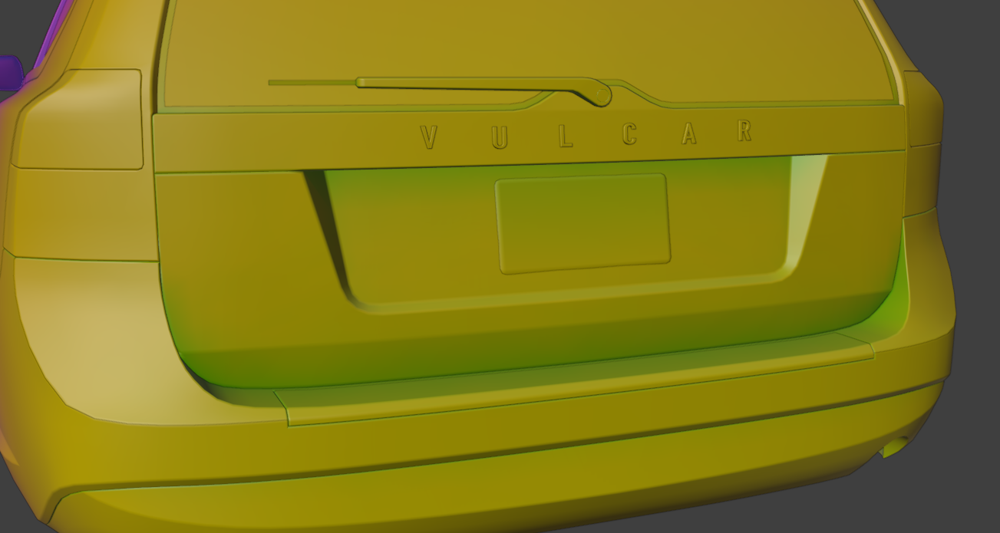
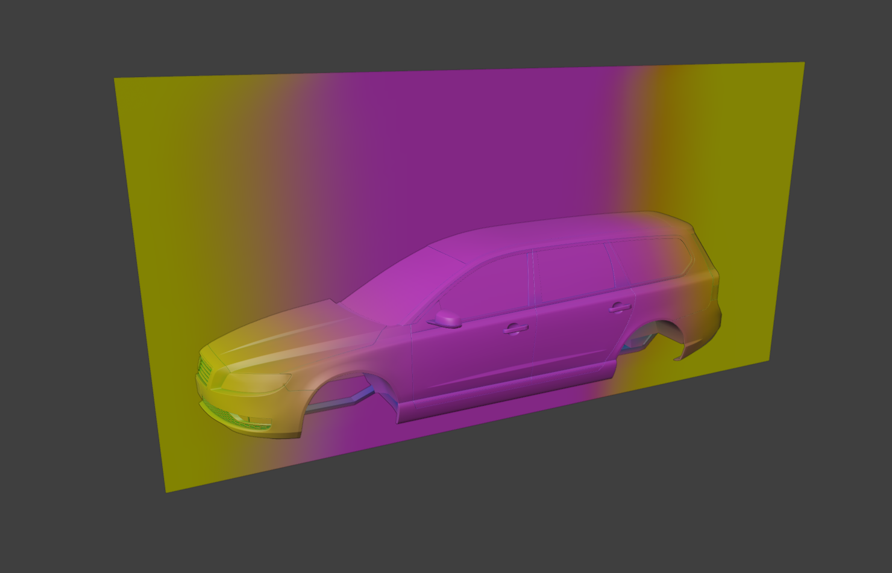
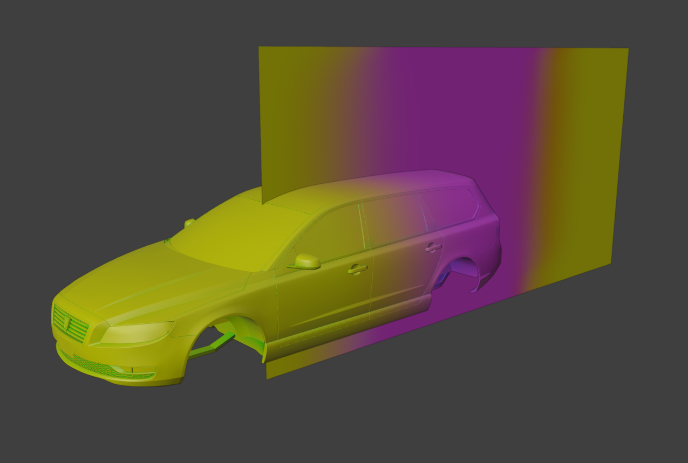
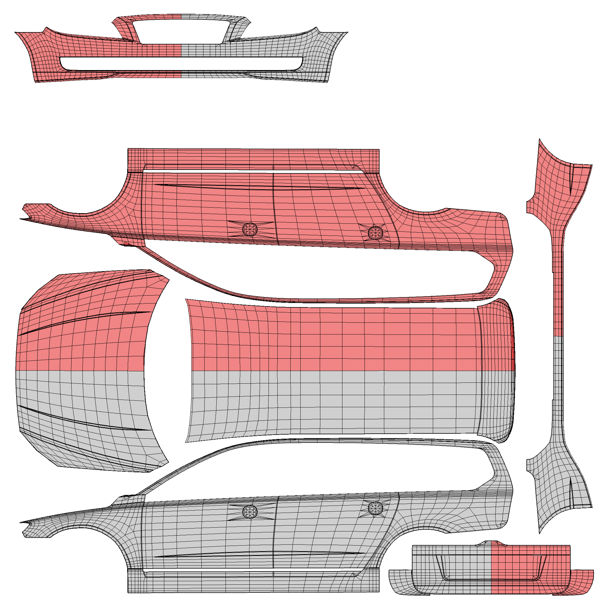
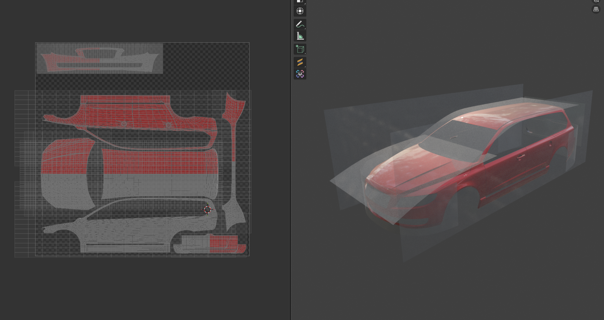

# T3D Tools

A Blender add-on with the tools for building GTA V vehicles in one place: modeling helpers, vehicle tools and mapping tools. No more juggling a pile of single-purpose scripts, one tab in the sidebar has all of them.

Everything lives in **3D Viewport → N panel → T3D Tools**, split into three categories:

| Category | Tools |
|---|---|
| **Modeling Tools** | Max Splines, Edit Constraints (with the Axis Move gizmo), Even Bevel, Object Utilities, Rivet Generator, Extrude (No Border Walls) |
| **Vehicle Tools** | UV Transfer, Normal Transfer, Panel Gap Generator, Livery Template, Channel Paint, Wheel Instancer, Light Baker, UV Pin |
| **Mapping Tools** | Floor Trim Generator |

Every tool is its own collapsible sub-panel and the panels only show what that tool needs.

---

## Features

- **One add-on, one tab.** Everything is in the T3D Tools sidebar tab, grouped by what you're doing.
- **Non-destructive where it matters.** UV Transfer, Normal Transfer, Even Bevel and Panel Gap keep their data on the object and can be changed or removed at any time.
- **Remembers its settings.** Rivet sets keep the settings they were built with, so going back to an older set doesn't use your newest settings.
- **Built for the GTA V workflow.** UV channels for dirt and glass dirt, chrome / black plastic palette spots, wheel dummies and light bakes.
- **Works with Mirror.** Extrude (No Border Walls), the rivet Mirror X option and the Axis Move gizmo all handle a half-modeled car.

---

## The tools

### Modeling Tools

| Tool | What it does |
|---|---|
| **Max Splines** | 3ds Max style spline creation and editing: Rectangle, Circle, Ellipse, Arc, Donut, NGon, Star, Helix and Line, plus Vertex Type, Refine, Divide, Break, Weld, Fillet, Chamfer, Outline, Explode, Attach and Convert To Spline |
| **Edit Constraints** | 3ds Max Edit Poly style constraints (None / Edge / Face / Normal) for moving, rotating and scaling in Edit Mode, plus the **Axis Move (Snap)** tool |
| **Even Bevel** | Bevels the selected edges but places the new vertices along the loop's own direction, so a bevel on a coarse oval stays round. Kept as an editable list of bevels |
| **Object Utilities** | One-click helpers, such as *Make Local + Clear Parent (Keep Transform)* for linked or library objects |
| **Rivet Generator** | Floating rivets and screw heads placed on any surface, see below |
| **Extrude (No Border Walls)** | Extrudes like **E**, but an edge with no face behind it (an open border, a mirror seam) gets no side wall |

### Vehicle Tools

| Tool | What it does |
|---|---|
| **UV Transfer** | Non-destructive, nearest-face-interpolated UV transfer from mapping planes (dirt and livery), pinned to the bottom of the modifier stack. A list of transfers, each with its own stored face set |
| **Normal Transfer** | Projects custom normals from other meshes onto selected faces. Same list-based workflow as UV Transfer, and it respects Mark Sharp edges |
| **Panel Gap Generator** | Bevel + vertex group + shrinkwrap panel gaps from your marked seam edges. Press Regenerate after changing width, segments or profile |
| **Livery Template** | Renders the UV layout to a PNG, colored by material or by side (left / right), with a preview-on-car mode |
| **Channel Paint** | Isolate, paint and fill a single vertex color channel (R / G / B / A), smooth vertex colors, bake AO into an attribute, copy and blend channels between attributes, and transfer G + B (optionally live, as a non-destructive modifier) |
| **Wheel Instancer** | Creates `wheel_lf`, `wheel_rf`, `wheel_lr` and `wheel_rr` dummies, instances a wheel collection on them and previews front-wheel steering and roll |
| **Light Baker** | Bakes a light housing and its point lights onto a separate light mesh with Cycles, see below |
| **UV Pin** | Collapses a UV channel of the selected faces or meshes to one pixel, see below |

### Mapping Tools

| Tool | What it does |
|---|---|
| **Floor Trim Generator** | Generates trim and decal strips along the border of a selected floor mesh or faces |

---

## Channel Paint

Besides isolating, filling and smoothing a single vertex color channel, Channel Paint can:

- **Bake AO** into a new Face Corner / Byte Color attribute (GTA keeps AO in R). Objects hidden in the viewport are left out of the bake.
- **Copy Channel** from one attribute/channel to another with Replace, Add, Subtract, Multiply, Divide, Lighten, Darken or Mix. **Delete Source After Copy** (on by default) removes the source attribute afterwards, so the baked AO attribute is cleaned up once it is in your main one.
- **Transfer G + B** from a source object (default `Vertex Plane`) by nearest surface. Tick **Update Live** and it becomes a non-destructive modifier that keeps following the plane, so you can move it and the colors update. **Bake Into Mesh** makes it permanent, **Remove** drops it.

### AO Bake

GTA stores ambient occlusion in the **R** channel of the vertex colors. The AO Bake panel does the baking in one click, and Copy Channel puts the result into your main attribute.

**1. Select the meshes.** Select every mesh you want to bake. The panel shows how many are selected. Meshes that share mesh data are only baked once.

**2. Set up the bake:**
- **Attribute:** the name of the new attribute (default `AO`). It is created as Face Corner / Byte Color, filled with white, and made the active color attribute. If an attribute with that name already exists it is replaced.
- **Samples:** Cycles samples for the bake. Higher is smoother but slower, a low number is fine for a quick check.
- **Distance:** how far occluders are looked for, in meters. Small distances only darken tight recesses and gaps, large distances also darken under bumpers and wheel arches. 0 keeps the distance already set on your world.
- **Only Visible Objects:** Blender normally bakes against everything that is renderable, including objects you have hidden in the viewport. With this on (the default), objects hidden in the viewport are temporarily left out of the bake, so only what you can see affects the AO. Hide anything you don't want to shadow the car (for example a mapping plane, a ground plane or a different LOD) and it will be ignored. They are restored afterwards.

**3. Press Bake AO.** The bake runs with Cycles into the active color attribute. Your render engine, samples, bake target and world distance are put back afterwards, and the result is made the active attribute.

**4. Tweak it in Vertex Paint.** Go into Vertex Paint and fix any errors with small edits, for example light leaking through a seam or a dark spot where a hidden part sat. The AO is stored in R, so use the same value on the channels you paint (white is no occlusion, black is full occlusion).

**5. Copy it into your main attribute** with the Copy Channel panel:
- **Src:** the attribute and channel to copy from. After a bake it is already filled in with `AO` / `R`.
- **Dst:** the attribute and channel to write to, usually your main color attribute and `R`.
- **Blend mode and Factor:** Replace writes the source value. Add, Subtract, Multiply, Divide, Lighten, Darken and Mix combine it with what is already in the destination, and Factor sets how much of the result is applied.
- **Delete Source After Copy** (on by default) removes the AO attribute once it has been copied, so the baked attribute doesn't stay behind on your mesh. Turn it off if you want to keep it.
- Press **Copy Channel**. It runs on every selected mesh that has both attributes.

Only the chosen channel is written, so the G, B and A of your main attribute are left alone.

### How the Vertex Plane works

The Vertex Plane is a simple helper mesh that holds the G and B values you want on the car, so you paint them once on a plane instead of directly on the car.

1. Make a plane (name it `Vertex Plane`, or pick another name in the Source field).
2. Subdivide it so it is rather dense. The more vertices, the finer the gradients you can paint.
3. Give it a Face Corner / Byte Color attribute and paint the G and B channels:
   - **G is deformation.** 1 is full deformation, 0 is none. For example, I typically use 0.325 for the greenhouse of the car.
   - **B is burn.** 1 is burnt, 0 is not burnt. It works like an alpha mask.
4. Place the plane next to or through the car, select the car and press **Transfer G + B**. Each car vertex takes the G and B of the nearest point on the plane. R and alpha on the car are left alone.

With **Update Live** ticked, moving or repainting the plane updates the car straight away.

---

## Livery Template

Renders the UV layout of your mapped parts to a PNG, to use as a guide when painting the livery.

### Color by side

The template above is colored by side: everything on the right of the object origin (+X) is red, everything on the left is grey. This is a good method to use in your viewport (see **Preview on Car** below) to make sure your mapping isn't just mirrored. If the two halves overlap in UV space, or the colors land on the wrong side of the car, you will see it straight away. Flip Sides swaps the two colors.

### Other options

- **Color by material:** colors faces with Material A or Material B in two colors, instead of by side.
- **Limit to materials:** in side mode, optionally restrict the template to the Material A / B slots.
- **UV channel:** which UV map to render (UV1 to UV4). The evaluated mesh is used, so UVs written by UV Transfer modifiers are included.
- **Resolution:** 512 up to 8192.
- **Background:** transparent, white or black.
- **Fill and UV edges:** toggle the colored fill (with opacity) and the wireframe, and set the line color and width.
- **Check Stretching:** finds stretched UVs by edge length and density ratio, lists them per object, lets you select the faces and can highlight them in the template.
- **Preview on Car:** puts the template on the car in the viewport (from the last generated one, or a fresh render of the current settings). Press Restore when you are done, before exporting.
- **Merge Copy for Export:** makes one merged copy of the mapped parts (modifiers applied, only the chosen materials kept), with the livery UV optionally moved to UV1, ready for Substance Painter.

---

## UV Transfer

UV Transfer copies UVs from mapping planes onto your car, live, with a modifier. Instead of unwrapping the car itself, you map the **livery** and the **dirt** onto flat planes, and the car reads its UVs from the planes.

### Workflow

Map your livery and dirt onto planes, which you then project onto your car. This is especially good when doing LODs and mod parts, when you need the mapping to line up perfectly: every part reads the same planes, so the UVs match exactly, whatever the topology of the part is.

### How it works

- For every vertex of the target, the modifier finds the nearest point on the plane's surface and takes the UV there, interpolated across the plane's face. The plane acts like a projector, and the car gets the mapping of whatever part of the plane it sits closest to.
- Each transfer reads one UV map of the plane (**From**, UV1 or UV2) and writes it into one UV map of the car (**To**, UV1 or UV2). Other UV maps are not touched.
- A transfer can have several **planes / channel pairs** (Add Plane / Channel), for example a livery plane to UV2 and a dirt plane to UV1. They share the transfer's face selection and material filter.
- You can add as many transfers as you need (Add Transfer). Each has its own name, planes, enable toggle and limits, and can be removed with all of its modifiers.
- Select the plane, Ctrl+click the car so it is active, and press the eyedropper next to **Plane** to set the source.

### Limit what gets written

- **Limit to Materials:** only faces using the listed materials get the UVs. Add Material starts with the active material slot.
- **Limit to Mesh Selection:** select faces in Edit Mode and press **Apply Selection**. Only those faces are written (combined with the material filter if both are on). **Get Selection** selects the stored faces again.

This is how you give the doors one plane and the roof another, or keep the glass out of the dirt mapping.

### Non-destructive

The transfer is a modifier that updates live. Do your edits and the mapping is preserved, nothing is baked into the mesh until you apply it.

The modifier is forced to the bottom of the stack, under Mirror modifiers. You can edit one side and the mapping will stay on the other side.

**Refresh UV Transfer** (the refresh button) re-reads the UV map names and rebuilds missing modifiers, for example after you opened an old file.

---

## Wheel Instancer

Puts one set of wheels on all four corners of the car with linked copies, so you model a single wheel and see it on every corner. It also previews steering and roll for renders. Wheel names follow the usual GTA `wheel_lf`, `wheel_rf`, `wheel_lr` and `wheel_rr` dummies.

### Workflow

1. **Create the dummies.** Set Wheelbase (distance between front and rear), Track (distance between left and right) and Radius (the height of the dummies, usually the wheel radius), then press **Create Wheel Dummies**. It makes the four empties `wheel_lf`, `wheel_rf`, `wheel_lr` and `wheel_rr`. Existing dummies are kept, so you can also place them yourself and just run the instancing.
2. **Put your wheel in a collection.** Put the wheel objects, including all of their LODs (`_L0`, `_L1`, ...), in one collection, and model them on the pivot you want. The collection's **Instance Offset** is used as the wheel's pivot, so set it to the wheel center. Keep the dummies outside of that collection.
3. **Pick the collection** in **Wheels**. Optionally set **Rear** to a different collection, for example for dually rear wheels. If it is empty, the rear uses the same wheels as the front.
4. **Press Instance Wheels.** Every object in the collection is copied onto all four dummies. The copies share mesh data with the originals, so they are cheap, and editing the wheel updates every corner. Each dummy gets a small pivot empty that handles steering, roll and flip. Run it again after adding or removing wheel objects, or after changing their transforms.
5. **Remove Instances** (the X button) deletes the copies and pivots and shows the original collections again. The dummies are kept.

### Settings

- **Flip Right Side:** rotates the right-side wheels 180 degrees around Z so the wheel faces outwards.
- **Hide Source:** hides the original wheel collections (viewport and render) while the instances exist.
- **Width Front / Width Rear:** scales the wheels along the axle, 1 is the original width. Good for staggered fitments.

### LODs

The instances follow the LODs of the rest of the car:
- **Follow Scene LODs** (on by default): wheel LODs whose `_L#` is not visible on the other `_L#` objects in the scene (body, glass and so on) are hidden. It works with LOD tools that hide objects or collections in any way, so when you switch the car to `_L1` the wheels do too.
- **Override LOD:** ignores the visibility of the source wheels and shows only the LOD you choose. Objects without an `_L#` are always shown.

### Preview

- **Steer:** turns the front wheels (positive is left), for checking clearance in the arches and for renders.
- **Roll:** spins the wheels around the axle, for variety in renders.
- **Reset Steering / Roll** puts them back.

The steering and roll are only on the instances, your original wheel is not changed.

---

## Rivet Generator

Rivets are real geometry that floats on top of the surface. A dished rivet looks pressed into the material because its normals are copied from the surface underneath, so you don't have to model an indent.

### Placing rivets

| Button | What it does |
|---|---|
| **Drag Over Surface** | Drag across the surface and a rivet drops every *Spacing*. Backspace removes the last one, Enter or right-click finishes |
| **Click to Place** | Single rivets |
| **Rivets on Selected Vertices** | One rivet per selected vertex (Edit Mode) |
| **Rivets Along Selected Edges** | Spread along the selected edges, by spacing or by count (Edit Mode) |
| **Rivets From Selected Faces** | Select a strip of quads. A hidden guide line (shown in the viewport, never rendered) runs along it. **Slide** moves it across the faces, **Start / End Offset** pull the first and last rivet in or push them past the end |

### Rivet settings

| Setting | Effect |
|---|---|
| **Style** | *Dished Rivet* (lip, inner ring and centre point) or *Screw Head* (round head sticking out, no lip, no AO) |
| **Radius / Sides / Inner Ratio** | Size and outline of the rivet |
| **Lip Height / Inside Offset / Centre Height** | The depth profile. A small Inside Offset keeps the surface from bleeding through |
| **Head Height** | Screw Head: how far the head sticks out |
| **Normal Strength** | How much of the surface's normals the rivet takes |
| **Use Surface Material** | Each rivet gets the material of the face under it |
| **Copy UVs and Colors** | UV maps and color attributes are read from the face under each rivet |
| **Inner AO** | Fake depth: darkens the red channel on the inner ring (not the centre), blended with the surface's own color attribute |
| **Mirror X** | A mirrored copy of every rivet. Rivets on the centre line aren't doubled |

Each rivet set stores the settings it was built with. Pick a set in the **Set** field, or select its object, and its settings load back. Press **Rebuild** after changing settings. The inner ring edges are marked sharp.

---

## Axis Move (Snap)

A gizmo tool for moving vertices along one line and snapping to another vertex.

1. In Edit Mode, pick **Axis Move (Snap)** in the left toolbar.
2. Handles appear on the selection. In **Edges** mode (the default) there is one handle per edge leaving the selected vertex, so you slide along the edge. Other modes: Normal, Global and Local.
3. Drag a handle. Move the mouse near another vertex and the selection snaps to the point on the line that lines up with that vertex on screen.
4. **Ctrl** flips snapping while dragging, a typed number gives an exact distance, release or Enter confirms and Esc or right-click cancels.

Turn off Blender's own move gizmo in the viewport Gizmos menu so the two don't overlap.

---

## Light Baker

Bakes the look of a light housing, the reflector, bulb and lens parts, onto a flat **light mesh** with its own UVs. In the game the light is then just a textured plane, but it shows the shading of the real housing, the way the light falls on the reflector and how it fades towards the edges. Cycles does the bake (Selected to Active), so the light mesh is the target and the housing objects are the source.

### Setup

1. **Light mesh (target):** the mesh that receives the bake. It needs UVs, and should be one UV island, because the edge fade works per island. Use the eyedropper to take the selected object.
2. **Housing (source):** add the housing meshes that are baked from (Add Selected Meshes). The light mesh itself is ignored if it is in the list.
3. **Point lights (for the lit bake):** add the point lights inside the housing (Add Selected Lights). Their color and power decide what the lit bake looks like.
4. **UV Map and Resolution:** which UV map (1 is the first) of the light mesh to bake into, and the size of the image, 512 up to 8192.
5. Set the paths for the images and press one of the bake buttons.

### Two bakes

- **Bake Lit:** the housing shading lit by the chosen point lights only. This is the light as it looks when it is on.
- **Bake Glass (no light):** the housing's own colors with no lighting, for the light when it is off.

Both are saved as PNGs to the Lit and Glass paths.

### Housing parts

With **Recolor Housing by Parts** on, the housing gets flat part colors during the bake, so you don't have to change your materials. Your normal maps are kept, and your materials are restored afterwards.

- Press a part button (Brake, Indicator, Headlight, Reverse, Custom) to add a part. Brake is red, Indicator is orange, Headlight and Reverse are white, and Custom lets you pick any color.
- In Edit Mode, select the faces of that part (it works across every mesh that is in Edit Mode) and press the check mark (**Apply Selection**) to store them. The arrow (**Get Selection**) selects the stored faces again.
- **Other Parts** is the color of every housing face that isn't in a part, by default almost black.

### The lit bake

- **Glass Bulb:** covers each point light in a frosted glass bulb, so the light comes from a small surface instead of a single point. It is softer and shows up in the housing's reflections. Set the **Bulb Radius** (small enough to fit inside the housing), **Bulb Brightness** (1 gives the same total light as the point light) and the **Glass Tint**.
- **Ignore World Light:** on by default, so only your point lights light the housing.
- **Reflections:** include glossy reflections. Turn it off for no shine at all.
- **Roughness:** use the housing's own roughness (multiplied by Scale, above 1 is more matte, below 1 is shinier), or one **Flat Value** for the whole housing, where 1 is fully matte.
- **Samples and Denoise:** more samples is cleaner and slower. Denoise runs Blender's OpenImageDenoise over the lit bake.

### Look of the result

- **Auto Exposure:** scales the lit bake so its bright areas reach full brightness, and **Exposure** adds extra stops on top.
- **Contrast:** 1 is unchanged, above 1 pushes brights brighter and darks darker.
- **Fade to Black and Edge Fade:** a soft border where the light fades to transparent, as a percentage of the image width, so it looks the same at any resolution. Fade to Black also darkens the color towards the edge, so the border never shows a color shift. Bright orange fades to black instead of shifting towards green or yellow, because the exposure and contrast are hue-preserving.
- **Lens Opacity:** the alpha of the baked texture. Below 1 the lens is slightly transparent, so it shows what is behind it in the game.
- **Opacity from Light:** makes dark areas transparent and lit areas opaque, so the light fades out where it gets weak. **Min Opacity** is the opacity of the darkest areas, and **Curve** decides how much light stays visible (above 1 only the strongest light stays opaque).
- **Save Alpha Map:** also writes the alpha as its own grayscale PNG (same name plus `_alpha`, white is opaque).
- **Base Texture:** blend the bake with an existing texture in the light mesh's UV layout. The modes are Mix (the bake covers the texture where it is opaque), Add, Multiply and Screen, and **Bake Strength** sets how strongly it is applied.

### Bake quality

- **Margin:** how many pixels the bake extends past the UV islands, so you get no seams.
- **Extrusion:** how far the rays start out from the light mesh. It must be bigger than the gap between the light mesh and the housing.
- **Max Ray Distance:** 0 is unlimited. Limits how far the rays reach into the housing.

### Apply to Light Mesh

Turn this on to give the light mesh a material using the baked image right after the bake (it replaces the mesh's current materials). For the lit bake the material is emissive, and **Emission** sets how much it glows (0 for none).

### Safe to use

Everything the bake changes (render engine, other lights, world, materials, modifiers, visibility, active UV map and selection) is put back afterwards.

---

## UV Pin

Collapses a UV channel of the selected faces (Edit Mode) or selected meshes (Object Mode) to a single pixel of a texture, so a mesh reads one flat value.

| Button | Where the UVs go |
|---|---|
| **Map Selected to No Dirt** | A clean pixel of the dirt texture |
| **Map Selected to No Glass Dirt** | The darkest solid spot of the glass dirt texture you pick |
| **Map Selected to Chrome** | The chrome palette spot (default U 0.250, V 0.925) |
| **Map Selected to Black Plastic** | The black plastic palette spot (default U 0.170, V 0.855) |

**Project First** flattens the UVs into one continuous planar projection (from the view, X, Y or Z) before pinning, so no broken seams are left.

---

## Requirements

- **Blender 4.2 or newer.** Developed and used on Blender 5.1.
- **Cycles** for the Light Baker.

---

## Installation

1. Download `t3d_tools_v1.2.0.zip` from the `download` folder. Don't unzip it.
2. In Blender, open **Edit → Preferences → Add-ons**, click the down arrow and choose **Install from Disk…**, then pick the zip.
3. Tick **T3D Tools** in the add-on list.
4. In the 3D viewport press **N** and open the **T3D Tools** tab.

To update, disable and remove the old version, **restart Blender**, then install the new zip. Blender doesn't reliably reload an add-on that is already loaded.

---

## Tips & troubleshooting

- **Panel missing?** Restart Blender after installing or updating. Check that **T3D Tools** is ticked in the add-ons list.
- **Two gizmos on top of each other?** Turn off Blender's own move gizmo in the viewport Gizmos menu while you use Axis Move (Snap).
- **Rivets have the wrong material, UVs or colors?** Press **Rebuild** on the rivet set. They are read from the face under each rivet when it's built.
- **Rivet looks flat?** Lower **Normal Strength** so it keeps some of its own shape, and check Inner AO.
- **Surface shows through a rivet?** Raise **Inside Offset** a little (0.0003 to 0.001).
- **Seams in a pinned UV?** Set **Project First** to a projection that faces the part, then pin again.
- **Edge colors shift in the Light Baker?** Use Fade to Black and lower the exposure instead of raising contrast.
- **Back up first.** Save your `.blend` before heavy operations such as baking, rebuilding many rivets or running the Even Bevel on a big mesh.

---

## Credits

- **Tidemo**: idea, design, testing and GTA V workflow
- **Claude** (Anthropic): code and documentation

Built with:

- [Blender](https://www.blender.org/) and its Python API

GTA V and Grand Theft Auto are trademarks of Rockstar Games / Take-Two Interactive. This is an unofficial fan tool and is not affiliated with or endorsed by Rockstar Games.
